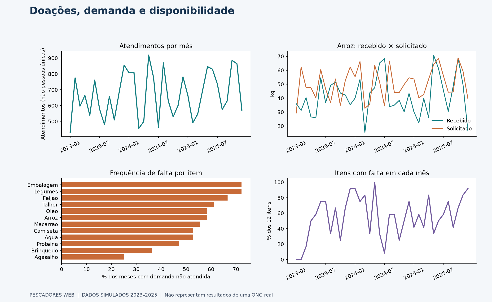
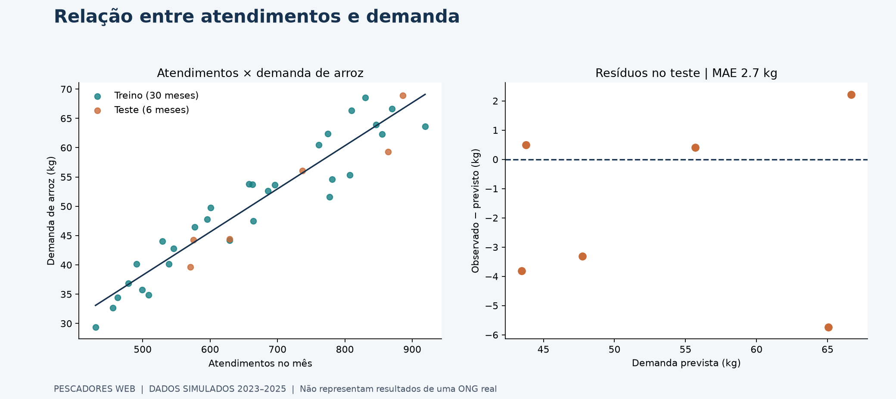
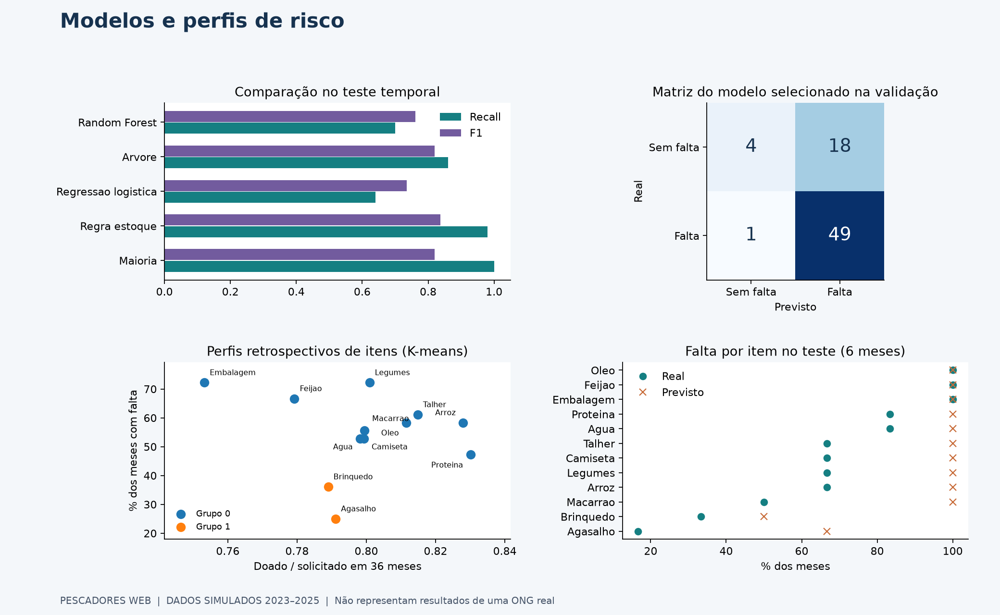

# Pescadores Web: doações, demanda e risco de falta de itens

[](https://colab.research.google.com/github/lipefe11/Ciencia_Dados_Aprendizagem_Maquina/blob/main/Projeto_ciencia_de_dados/notebooks/pescadores_crispdm.ipynb)

Projeto de Ciência de Dados ligado ao TCC **Pescadores Web**, sistema de gestão de
doações, estoque, voluntários e ações sociais. Aplica CRISP-DM a uma pergunta de
planejamento de recursos:

> **Como as doações recebidas se comparam à demanda das ações sociais, e é possível
> antecipar a falta de itens no mês seguinte?**

**Dados inteiramente simulados.** Não são registros da ONG nem microdados do
Panorama das ONGs. O exercício demonstra um método; não comprova desempenho real,
impacto social ou aumento de arrecadação. O sistema Laravel/MySQL do TCC e esta
análise Python/SQLite são componentes distintos. O protótipo não está integrado ao sistema.

## Contexto e fontes

O artigo da [HYB](https://blog.hyb.com.br/panorama-das-ongs-no-brasil-desafios-e-perspectivas-do-terceiro-setor/)
foi o ponto de partida para o tema. A [publicação do IDIS, parceiro da pesquisa com a CAF](https://www.idis.org.br/panorama-das-ongs-estudo-revela-resiliencia-do-terceiro-setor-no-brasil/)
informa participação de 170 ONGs brasileiras e destaca sustentabilidade financeira,
gestão e transparência. Isso fundamenta a relevância do tema, sem fornecer os
registros operacionais necessários para prever estoque. Ver [referências](docs/REFERENCIAS.md).

## Perguntas e entregas

| Pergunta | Técnica | Entrega |
|---|---|---|
| Como evoluem atendimentos e recebimentos? | SQL e séries mensais | Dashboard de visão geral |
| Quais itens apresentam falta com mais frequência? | Agregação por item e balanço de estoque | Ranking e cobertura da demanda |
| Como atendimentos se relacionam à demanda de arroz? | Dispersão e regressão linear | Reta ajustada e resíduos no teste |
| Há perfis de itens com comportamentos semelhantes? | K-means com atributos padronizados | Comparação de k e silhueta |
| É possível antecipar falta no mês seguinte? | Regra operacional, regressão logística, árvore e Random Forest | Validação e teste temporal, métricas e matriz de confusão |

Não se somam kg, litros e unidades. Atendimentos representam participações nas
ações, não pessoas únicas. Os clusters são retrospectivos e não entram no classificador.

## Resultados da execução de referência

- 12 itens, 36 meses (2023–2025), 432 item-meses e 143 ações simuladas.
- Cinco registros incorretos inseridos de propósito são identificados e removidos.
- O modelo é escolhido pelo F1 na validação, incluindo regras simples entre as opções.
- Na execução de referência, a regra de estoque foi selecionada. O método não presume
  que um algoritmo complexo será melhor.
- As métricas, tamanhos das amostras e limitações estão em [RESULTADOS.md](resultados/RESULTADOS.md).

## Dashboard







## CRISP-DM

1. **Negócio:** apoiar a revisão de estoque e o planejamento de campanhas.
2. **Dados:** conhecer as tabelas, o período, as unidades e as regras do simulador.
3. **Preparação:** validar recebimentos, calcular balanço e características históricas.
4. **Modelagem:** ajustar regressão, agrupamento e classificadores, comparando baselines.
5. **Avaliação:** selecionar na validação e avaliar no período final reservado.
6. **Implementação:** demonstrar um arquivo de alertas e propor acompanhamento mensal.

O [notebook](notebooks/pescadores_crispdm.ipynb) percorre essas etapas. O
[plano de análise](docs/PLANO_ANALISE.md) adapta o planejamento do TCC para esta entrega.

## Executar

Requer **Python 3.12 ou superior**. No terminal, entre nesta pasta:

```bash
python -m venv .venv
# Windows PowerShell:
.venv\Scripts\Activate.ps1
# Linux/macOS:
# source .venv/bin/activate
python -m pip install -r requirements.txt
python scripts/analise.py
python -m unittest discover -s tests -v
python scripts/gerar_relatorios.py
```

`analise.py` recria os dados simulados e sobrescreve seus resultados gerados nesta
pasta. Não substitua os CSVs brutos por dados reais para executar esse comando.
Para dados reais, adapte e revise o carregamento, as regras e a validação em uma
cópia separada. `requirements-lock.txt` registra as versões da execução de referência.

No Colab, abra o notebook e selecione **Ambiente de execução → Executar tudo**.
O notebook instala dependências ausentes e baixa a pasta do repositório quando necessário.
Os resultados podem ser consultados no GitHub sem executar nada.

## Estrutura

```text
Projeto_ciencia_de_dados/
  dados/brutos/          tabelas simuladas, incluindo erros conhecidos
  dados/tratados/        base analítica, qualidade, métricas, perfis e alertas
  Dashboard/            três páginas de gráficos em PNG
  docs/                 plano, dicionário, referências e relatório em PDF
  notebooks/            notebook CRISP-DM com saídas executadas
  resultados/           conclusões, resumo JSON e resultados SQL em CSV
  scripts/              pipeline e geração dos relatórios
  sql/                  oito consultas SQLite
  tests/                verificações de estoque, dados e separação temporal
  requirements.txt
```

## Autoria e escopo

TCC de referência: **Felipe Barbosa Vieira e Calebe Mendes Bezerra**, conforme o
[documento original](../Definicao_Projeto_PescadoresWeb_v2.docx). Esta pasta contém
um protótipo acadêmico de análise, com código e documentação preparados com auxílio
de IA. As premissas e os resultados precisam ser revisados e compreendidos pela equipe.
O documento original do TCC foi preservado, sem apresentar entregas previstas como concluídas.
